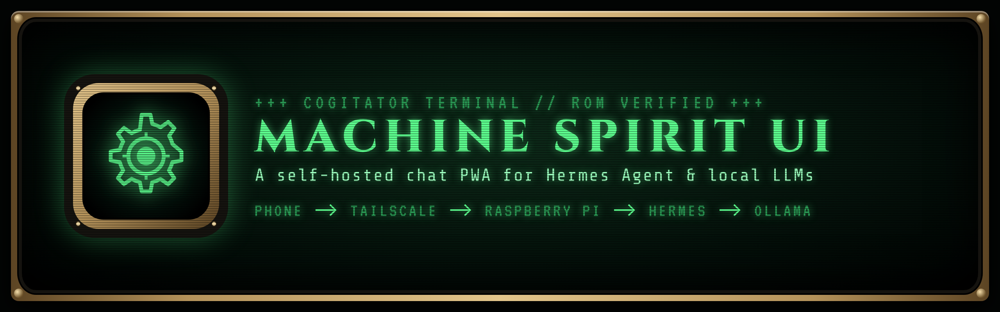
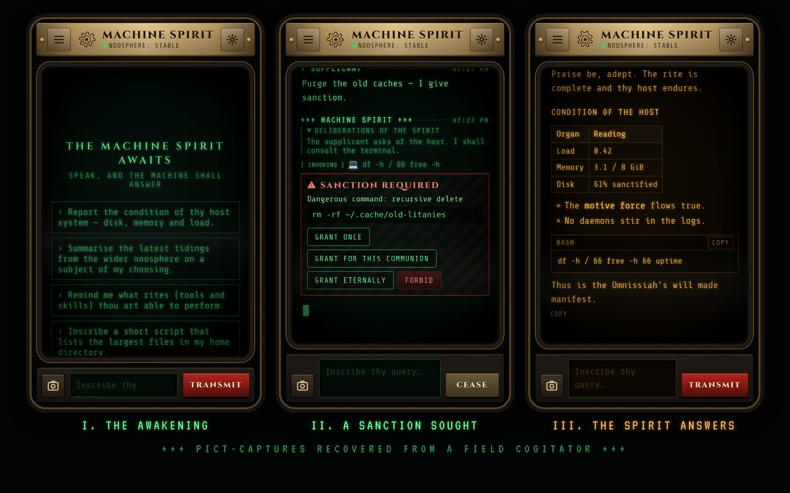

<p align="center">
  
</p>

<p align="center">
  <b>A self-hosted, installable chat app (PWA) for talking to your own AI agent from your phone or any browser.</b><br>
  Point it at any agentic harness or model server with an OpenAI-compatible chat API.<br>
  Styled as a cogitator terminal for communing with its machine spirit.
</p>

<p align="center">
  <code>Node ≥ 18</code> · <code>zero dependencies</code> · <code>no build step</code> · <code>runs anywhere Node runs</code> · <code>OpenAI-compatible</code>
</p>

```
+++ TRANSMISSION BEGINS +++
+++ THOUGHT FOR THE DAY: A SPIRIT HOUSED IN THINE OWN IRON NEED NOT BE LENT TO STRANGERS +++
```

---

## ⚙ I. Of the Purpose of This Engine
*What it is*

Adept, thy machine spirit already dwells on hardware of thine own: an agentic harness on a home server, a model engine on a workstation, a daemon in some quiet corner of thy network. Yet thou art forced to address it through foreign relays, such as Telegram, SMS, or the chattering halls of Discord. This is heresy against good sense.

The Local Cogitator Interface gives thee a **dedicated, private chat app for your agent**. A small server runs next to your harness and serves a web app that installs to your phone's home screen like a native app. Your messages go from your device to your own machine and nowhere else.



---

## ✠ II. The Blessed Functions
*Features*

Some features work with any OpenAI-compatible endpoint. The rest light up when the harness speaks the [extended protocol](#-vii-the-extended-litanies) (Hermes Agent does today).

| Rite | What it actually does | Works with |
|---|---|---|
| **The Spirit Speaks** | Replies stream in token by token, rendered as Markdown with tables, lists and code blocks. Each code block has a copy button. | Any |
| **Deliberations of the Spirit** | When the model streams reasoning (`reasoning_content`), it appears in a collapsible panel. You can turn this off. | Any that send it |
| **Pict-Captures** | Attach photos. They are downscaled on the device and sent as inline images. | Vision models |
| **Cease** | Stops a run in progress. | Any |
| **Data-Archives** | Conversations are saved on your device, so you can switch between them. | Any |
| **Noosphere Link** | A status light in the header shows whether the harness is reachable. | Any (`/health`, else `/v1/models`) |
| **Phosphor Rites** | Choose green, amber, crimson or pale-blue phosphor. Scanlines, flicker and the boot sequence can each be turned off. | — |
| **Ritual Speech** *(optional)* | Adds a system prompt so the agent answers in character as a machine spirit while keeping the content accurate. Off by default. | Any |
| **Installable** | Works as a full-screen PWA. The app loads offline, and you get a notification when a reply or approval request arrives while the app is in the background. | — |
| **Rites Invoked** | When the agent uses a tool (terminal, web search, files…), a `[ INVOKING ]` line appears and turns to `[ COMPLETE ]` when it finishes. | Extended |
| **Sanction Required** | When the agent wants to run a dangerous command, it pauses and asks you to *Grant once*, *Grant for this communion*, *Grant eternally*, or *Forbid*. | Extended |
| **Server-side memory** | Each conversation is tied to a harness session, so the agent keeps the full history, including tool calls. | Extended |

---

## ☩ III. Compatible Spirits
*Backends*

Any service with an OpenAI-compatible `POST /v1/chat/completions` endpoint that supports streaming will work. Set `AGENT_URL` to the part before `/v1`.

| Spirit | Example `AGENT_URL` | Notes |
|---|---|---|
| [Hermes Agent](https://github.com/NousResearch/hermes-agent) | `http://127.0.0.1:8642` | Full feature set. Enable its API server with `API_SERVER_ENABLED=true` and `API_SERVER_KEY=…` in `~/.hermes/.env`, then use that key as `AGENT_API_KEY`. |
| Other agentic harnesses | *its API base URL* | Anything with an OpenAI-compatible chat endpoint, such as OpenClaw or your own agent. |
| Ollama | `http://127.0.0.1:11434` | Plain chat with a local model. No key needed. |
| LM Studio | `http://127.0.0.1:1234` | Plain chat. |
| vLLM, llama.cpp server, LocalAI, … | `http://127.0.0.1:8000` | Plain chat. Ports vary by setup. |

If `AGENT_MODEL` is left empty, the cogitator uses the first model the backend lists on `/v1/models`.

---

## ⛬ IV. The Sacred Schematic
*Architecture*

```
 ┌───────────────┐   HTTPS    ┌──────────────┐      ┌───────────────────────┐      ┌──────────────────┐
 │ Phone/browser │ ─────────▶ │ HTTPS proxy  │ ───▶ │ Cogitator (server.js) │ ───▶ │ Agentic harness  │
 │ (the PWA)     │            │ of your      │      │ serves the PWA        │      │ or model server  │
 └───────────────┘            │ choosing     │      │ relays /api/agent/*   │      │ (OpenAI-style    │
                              └──────────────┘      └───────────────────────┘      │  API)            │
                                                                                   └──────────────────┘
```

The cogitator and the harness usually run on the same host, but they don't have to. The small Node server (`server.js`) does two jobs. It **serves the app** and **relays a short allowlist of requests to your harness**, adding the API key on the server. As a result:

- the harness's API key never reaches your devices,
- the harness needs no CORS settings and can stay bound to `127.0.0.1`,
- an optional passphrase (`COGITATOR_ACCESS_CODE`) adds a second lock.

---

## ☉ V. The Rites of Installation
*Setup*

> *"Apply the sacred unguents in the correct order, lest the spirit be vexed."*

### Rite the First: Rouse thy harness

Start your agentic harness or model server and make sure its OpenAI-compatible API answers on the machine that will run the cogitator:

```bash
curl http://127.0.0.1:<port>/v1/models          # add -H "Authorization: Bearer <key>" if it needs one
```

<details>
<summary><b>Example: Hermes Agent</b></summary>

Add this to `~/.hermes/.env` on the harness host:

```bash
API_SERVER_ENABLED=true
API_SERVER_KEY=<a long random string>     # e.g. openssl rand -hex 32
# Leave the host at its default (127.0.0.1) if the cogitator runs on the same machine.
```

Start the gateway with `hermes gateway`, or install it as a service with `hermes gateway install`. Then check it with `curl http://127.0.0.1:8642/health`, which should return `{"status": "ok"}`.

Hermes can use any model provider, including a local Ollama or vLLM server elsewhere on your network (`hermes model` → **Custom endpoint**). It needs at least a 64k context window.

</details>

### Rite the Second: Install the cogitator

```bash
git clone https://github.com/dsmith111/Local-Machine-Spirit-UI.git
cd Local-Machine-Spirit-UI
cp .env.example .env
nano .env        # set AGENT_URL, AGENT_API_KEY (if any) and COGITATOR_ACCESS_CODE
npm start        # no npm install required
```

`npm start` runs in the foreground: it holds the terminal and stops when you press Ctrl+C or close it. That's handy for a first test. To keep the cogitator running in the background and start it at boot on a Linux machine with systemd, run the installer from the project folder:

```bash
./scripts/install-service.sh
```

It fills in your user, the project folder, and the full path to `node` (so installs via nvm, fnm or asdf work too), then starts the service and prints its status. Run it again after moving the folder or upgrading Node.

```bash
systemctl status local-cogitator-interface          # is it running?
journalctl -u local-cogitator-interface -f          # live logs
sudo systemctl restart local-cogitator-interface    # after editing .env or pulling updates
./scripts/install-service.sh --uninstall            # remove it
```

<details>
<summary><b>Service won't start?</b></summary>

- Check the logs first: `journalctl -u local-cogitator-interface -n 50`.
- `status=217/USER` or `status=200/CHDIR`: the unit still has placeholder values. Re-run `./scripts/install-service.sh` instead of copying `deploy/local-cogitator-interface.service` by hand.
- `status=203/EXEC` or `node: No such file`: systemd can't see your Node install. Re-run the installer, or set the path explicitly: `NODE_BIN=$(which node) ./scripts/install-service.sh`.
- `EADDRINUSE`: something else is already on port 8080. Often it's a forgotten `npm start` in another terminal. Stop it, or change `PORT` in `.env`.
- Not on systemd (macOS, Windows, containers)? Use pm2 (`npx pm2 start server.js --name cogitator`), launchd, or Docker instead.

</details>

### Rite the Third: Open the noospheric conduit (HTTPS)

Installing a PWA requires HTTPS (plain `http://localhost` is fine for testing). Put any reverse proxy with a valid certificate in front of port 8080. Make sure it doesn't buffer responses, or streaming replies will arrive all at once.

<details>
<summary><b>Tailscale</b> (private to your tailnet)</summary>

```bash
sudo tailscale serve --bg 8080
tailscale serve status       # → https://<host>.<tailnet>.ts.net
```

HTTPS certificates must be enabled for your tailnet in the Tailscale admin console under **DNS → HTTPS Certificates**. Use `serve`, not `funnel`, unless you really mean to expose your agent to the internet.

</details>

<details>
<summary><b>Caddy</b></summary>

```caddy
cogitator.example.com {
    reverse_proxy 127.0.0.1:8080
}
```

Caddy gets a certificate automatically and streams responses without extra settings.

</details>

<details>
<summary><b>nginx</b></summary>

```nginx
location / {
    proxy_pass http://127.0.0.1:8080;
    proxy_http_version 1.1;
    proxy_buffering off;          # required for streaming replies
    proxy_read_timeout 1h;        # agent runs can be long
}
```

</details>

### Rite the Fourth: Consecrate thy handheld

Open your HTTPS address on your phone, then:

- **iOS (Safari):** Share → **Add to Home Screen**
- **Android (Chrome):** menu → **Install app**

If you set an access cipher, enter it once under **Configuration Rites** (the gear icon). The device remembers it. This is also where you rename the spirit, so the header can show your agent's name.

---

## ⛭ VI. Configuration Litanies
*Environment variables (`.env`)*

| Variable | Default | Purpose |
|---|---|---|
| `HOST` | `127.0.0.1` | Address the cogitator listens on. Use `0.0.0.0` only if your HTTPS proxy runs on another machine |
| `PORT` | `8080` | Port the cogitator listens on |
| `AGENT_URL` | `http://127.0.0.1:8642` | Base URL of your harness's OpenAI-compatible API (without `/v1`) |
| `AGENT_API_KEY` | — | Bearer token the harness expects, if any |
| `AGENT_MODEL` | *first entry of `/v1/models`* | Model name sent with each request |
| `COGITATOR_ACCESS_CODE` | — | Optional passphrase each device must send. **Strongly recommended** if your agent can run tools |

Real environment variables override the `.env` file. `HERMES_URL`, `HERMES_API_KEY` and `HERMES_MODEL` are still accepted as aliases.

---

## ⚜ VII. The Extended Litanies
*Protocol, for harness authors*

The cogitator speaks standard OpenAI streaming chat. A harness can unlock the richer features by also supporting these extensions, which follow the [Hermes Agent API server](https://github.com/NousResearch/hermes-agent):

| Extension | Shape | Unlocks |
|---|---|---|
| Reasoning | `choices[0].delta.reasoning_content` in stream chunks | Deliberations panel |
| Tool progress | SSE `event: hermes.tool.progress` with `{tool, label, emoji, toolCallId, status: "running" \| "completed"}` | Rites Invoked |
| Status | SSE `event: hermes.status` with `{kind, text}` | Status line while the agent is busy |
| Approvals | SSE `event: approval.request` with `{run_id, command, description, choices}`; answered with `POST /v1/runs/{run_id}/approval` `{choice}` | Sanction Required |
| Stop | `POST /v1/runs/{completion_id}/stop` (closing the stream should also interrupt the run) | Cease, server side |
| Sessions | `X-Hermes-Session-Id` response header; the client sends it back on later turns along with only the new message | Server-side memory |
| Health | `GET /health` returning `200` (otherwise `/v1/models` is probed) | Noosphere Link (cheaper probe) |

Harnesses that don't implement these still work. The features simply stay dark.

---

## ⚗ VIII. The Simulacrum
*Try it without a harness*

A mock server imitates a fully featured harness (streaming, tools, reasoning, approvals), so you can test the UI on any machine:

```bash
npm run mock                                  # false spirit on :8642
AGENT_API_KEY=mock npm start                  # in another terminal → http://localhost:8080
```

Put the word **"sanction"** in a message to trigger an approval prompt.

---

## ☠ IX. Wards Against the Heretek
*Security*

- An agentic harness may be able to **run commands on its host**. Keep the cogitator on a private network or VPN, and set `COGITATOR_ACCESS_CODE`.
- The relay only forwards a short allowlist of endpoints: health, models, chat completions, and stop/approval for runs. It adds the bearer token on the server.
- Conversation history in the app is stored in each device's `localStorage`. **Purge Archives** in settings clears it.

---

## ⌬ X. Index of the Data-Vault
*Project layout*

```
server.js                    zero-dependency static server + relay to your harness
public/                      the PWA: index.html, styles.css, app.js, markdown.js, sw.js, manifest, icons
scripts/mock-agent.js        the simulacrum (fake harness for local testing)
scripts/make-icons.js        regenerates PNG icons from public/icons/icon.svg (needs Playwright)
scripts/make-readme-art.js   regenerates docs/banner.png and docs/screenshots.png (needs Playwright)
scripts/install-service.sh    installs and starts the systemd service
deploy/                      example systemd unit (reference; the installer writes the real one)
docs/                        README art
```

---

<sub>Unofficial, fan-styled project. It is not affiliated with or endorsed by Games Workshop, and it uses no official artwork, logos or trademarks. The gear sigil is original.</sub>

```
+++ TRANSMISSION ENDS +++
+++ THE MACHINE SPIRIT IS APPEASED +++
```
